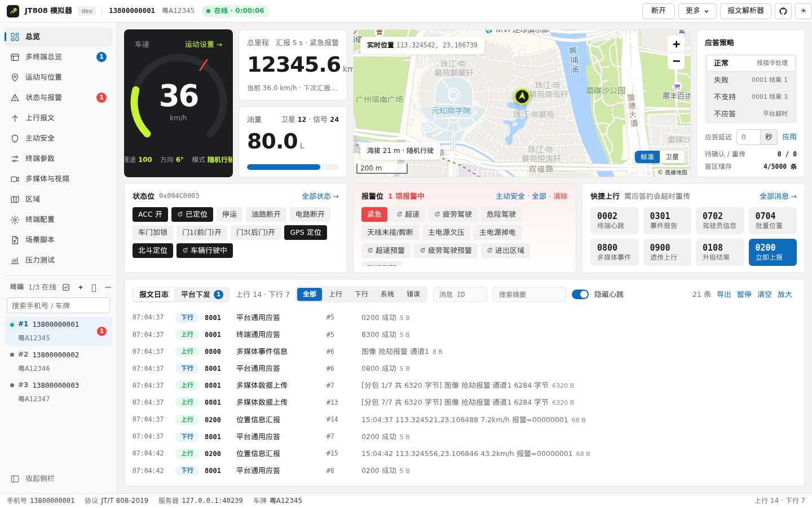
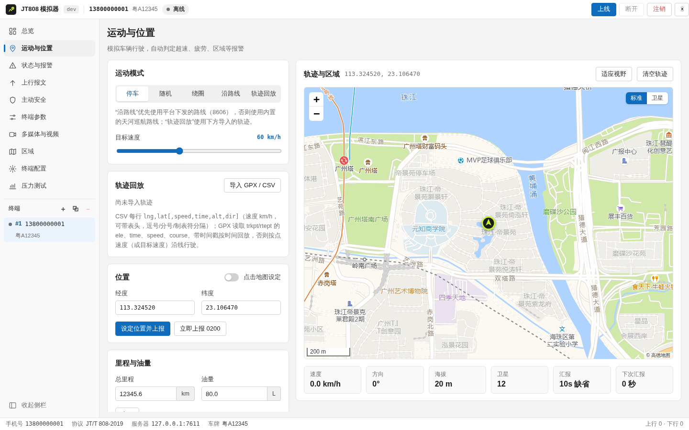

# jt808sim：JT808 终端模拟器

按真实车载终端的行为模拟 JT/T 808-2013/2019 + JT/T 1078 + 主动安全（苏标 JSATL12 / 粤标 T/GDRTA 002-2020，按终端切换）。
单个 exe，无运行依赖（页面、样式、脚本和地图库 Leaflet 都内置在 exe 里，不依赖 CDN）；推荐直接使用 Windows 桌面版；命令行版 `jt808sim-cli` 可无界面运行（交互命令、脚本、场景回归）。终端状态（参数、鉴权码、里程、区域、多媒体、盲区数据）
按手机号保存在 `state/<phone>.json`，重启后保留，与真实设备掉电保存一致。






## 桌面版（Windows，推荐）

从 [Releases](../../releases) 下载：

- `jt808sim-<版本>-windows-x64-setup.exe`：安装包，装到 `%LOCALAPPDATA%\Programs\jt808sim`，不需要管理员权限，带开始菜单和桌面快捷方式。
- `jt808sim-<版本>-windows-x64-portable.zip`：免安装，内含 `jt808sim.exe`（桌面窗口）和 `jt808sim-cli.exe`（命令行版）。

双击 `jt808sim.exe` 打开窗口：无边框窗口，标题栏（拖动、双击最大化、最小化/最大化/关闭）、左侧导航和底部状态栏都在页面里绘制；窗口宽度小于 1360 时侧栏收起为图标。实现方式：程序在 `127.0.0.1` 随机端口启动内置服务，用 Wails（WebView2）窗口加载，只监听本机。
终端状态保存在 `%APPDATA%\jt808sim\state`，卸载或升级都会保留。只允许运行一个实例。
需要 WebView2 运行库，Windows 10/11 一般已自带。地图底图为高德在线瓦片（标准 / 卫星），需要联网。
带任何命令行参数启动时进入命令行（无界面）模式（一般用不到，见文末「命令行模式（可选）」）。
内置服务的每个请求都必须带启动令牌（页面经 `?k=` 带入后写入 HttpOnly cookie），并校验 Host 为回环地址，本机其它进程和网页无法访问接口。v1.5.0 起移除了 `-web`（浏览器访问）模式。

本地构建桌面版（可在 Linux / macOS 交叉编译，不需要 CGO）：

```
GOOS=windows GOARCH=amd64 CGO_ENABLED=0 go build -tags desktop,production -ldflags "-H windowsgui" -o jt808sim.exe .
```

图标与清单由 CI 用 `go-winres` 从 `build/icon.png` 生成，安装包脚本为 `build/installer.nsi`。

### 记住窗口

退出时把窗口位置、大小和是否最大化写到状态目录下的 `window.json`（`%APPDATA%\jt808sim\state\window.json`），下次启动恢复，最大化的窗口仍在原显示器上最大化。运行中每 15 秒也会自动保存一次（有变化才写），进程被强杀同样不丢。
恢复前检查标题栏是否落在某个显示器的工作区内：拔掉副屏、改了分辨率或缩放后位置不可见时，自动居中到主显示器；窗口比当前屏幕大时缩小到工作区。
删除 `window.json` 即恢复默认（1440×900 居中）。

### 检查更新

桌面版启动后会检查 GitHub 上的最新发布（之后每小时一次；窗口重新激活时若距上次检查超过 10 分钟也会补查；点标题栏的版本号可立即手动检查）。有新版本时标题栏出现「新版本」标记并弹窗显示更新说明：

- 安装版：点「立即更新」，程序下载安装包、按 `SHA256SUMS` 校验后启动安装程序并自动退出，装完即是新版本；终端状态保留。
- 便携版：点「去下载」打开发布页，手动替换 exe。
- 「跳过此版本」后不再自动提醒该版本，手动检查仍会显示。

可选：构建时注入了 minisign 公钥（CI 变量 `MINISIGN_PUB`，见「CI/CD」）的安装包还会强制校验 Release 里的 `.minisig` 签名，验签失败拒绝安装——`SHA256SUMS` 与安装包同源，签名才是独立的信任链。

## 终端行为

**链路**：无鉴权码先注册（0100），再鉴权（0102）；鉴权失败自动清码重新注册。
心跳按 0x0001，只在无其它上行时发送。需要平台应答的上行按 0x0002/0x0003 超时重传，超时按标准
T(n+1)=T(n)×(n+1)（T0、T0、2T0、6T0、24T0…），心跳重传失败判定掉线。传输方式见下文「TCP / UDP」。
断线按 2s→60s 退避自动重连，主服务器连续失败 3 次后交替尝试备份服务器（0x0017）。
上行 > 1000 字节自动分包，平台 8003/8800 可要求补传指定分包；下行分包自动重组，2019 版超时未收齐发 0005 请求补传。

**位置汇报**：按 0x0020 定时/定距/定时+定距、0x0021 ACC/登录状态选择 0x0022/0x0027/0x0028/0x0029 等间隔；
状态位或报警位变化立即汇报；拐点补传（0x0030）；8202 临时跟踪。离线期间的位置进盲区，上线后用 0704 类型 1 补报。
盲区队列默认最多 5000 条（「终端配置 → 行为 → 盲区补报队列上限」可改为 10~100000，接口字段 `blindCap`），超出时丢弃最旧的并在日志、状态栏告警；主屏「应答策略」卡片显示 `当前/上限` 与已丢弃条数。
附加信息带里程、油量、行驶记录速度、0x25 扩展车辆信号状态位、0x2A IO 状态位、0x2B 模拟量（AD0/AD1）、信号强度、卫星数，
按需带 0x04/0x11/0x12/0x13/0x14~0x18。0x25/0x2A/0x2B 在页面「状态与报警」逐位切换 / 填写。

**运动与自动报警**：停车/行驶/绕圈/路线（平台下发路线 8606 时沿拐点行驶）/轨迹回放（导入 GPX / CSV，见下文）。
超速（0x0055/0x0056）与超速预警（0x005B）、疲劳驾驶（0x0057/0x0059）与预警（0x005C）、
当天累计驾驶超时（0x0058）、超时停车（0x005A）、进出区域/路线（区域属性 bit3/bit5）、区域限速，
路段行驶时间不足/过长（8606 拐点的路段属性 bit0 + 过长/不足阈值，驶离路段时报 bit22 + 附加信息 0x13），
违规行驶（2019 报警位 bit15：在 0x0032 违规行驶时段内行驶；2013 无此报警位，只保存参数），由模拟器自动判定；
页面上这些位带「自动判定」图标（悬停提示「由模拟器自动判定」），在「状态与报警」点位右侧的锁可**锁定**为当前值：锁定后自动判定和平台确认都不再改写它，手动点击切换锁定值，再点锁解除（接口 `{"type":"lockAlarm","bit":1,"lock":1,"on":0}`，锁定随终端状态保存）；
0x0050 报警屏蔽字生效。紧急报警等需人工确认的报警在 8203 / 8001(结果 4) 后清除。
报警拍摄开关 0x0052 / 存储标志 0x0053：紧急报警、碰撞侧翻触发拍照；0x0064/0x0065 定时/定距拍照。

**下行指令**

| 指令 | 终端行为 |
|---|---|
| 8103 / 8104 / 8106 | 参数表 100+ 项（见下文「终端参数」），未知参数按原始字节保存并回报 |
| 8105 | 1 无线升级（http 地址实际下载，0108 回报）2 连接指定服务器 3 关机 4 复位 5 恢复出厂 6/7 关闭通信 |
| 8107 / 8108 | 0107 属性；升级包逐包应答，收齐后校验长度并 0108。8108 制造商ID：2013 为 BYTE[5]，2019 为 BYTE[11]（长度对不上时自动尝试另一种） |
| 8201 / 8202 / 8203 / 8204 | 0201 / 临时跟踪 / 人工确认报警 / 链路检测 |
| 8300 / 8301 / 8302 / 8303 / 8304 | 文本、事件、提问（页面选答案回 0302）、点播菜单、信息服务 |
| 8400 / 8401 | 电话回拨 / 电话本 |
| 8500 | 2013：控制标志 bit0（1 加锁 0 解锁）；2019：控制类型列表，0x0001 车门（参数 0 车门锁闭、1 车门开启），其它控制类型回 0001 结果 3（不支持）。另兼容网关旧 4 字节编码（标志+类型+参数）与 jt808-server（yezhihao）的 3 字节编码（类型 WORD + 参数 BYTE，1 加锁 0 解锁，缺少控制类型数量）。0500 带最新状态（状态位 bit12） |
| 8600~8608 | 圆形/矩形/多边形/路线 设置、删除、0608 查询 |
| 8700 / 8701 | GB/T 19056 00H~15H 采集（含 08H~15H 记录块）/ 82H~C4H 参数设置 |
| 8801~8805 | 真实 JPEG（分辨率/质量按指令）、WAV 录音、检索/批量上传/单条上传、0800 + 0801 |
| 8900 / 8A00 | 下行透传 / 保存平台 RSA 公钥并回终端 RSA 公钥 0A00（见「RSA 消息体加密」） |
| 9003 | 1003：G.711A 8kHz、H.264、4 路 |
| 9101 / 9102 | TCP/UDP 推 JT1078 RTP 流（H.264 testsrc 352×288 15fps + G.711A），关闭/暂停/恢复/关音频 |
| 9201 / 9202 / 9205 | 回放（先回 1205）及暂停/倍速/拖动；资源列表按整点生成 |
| 9206 / 9207 | FTP 上传录像，1206 通知；暂停/继续/取消 |
| 9208 / 9212 | 0001 后连附件服务器，1210 / 1211 / 文件码流 / 1212，按 9212 补传 |
| 9301~9306 | 云台类指令记录后成功应答 |

**状态文件持久化**：`state/<phone>.json`、`terminals.json`、`scenarios.json`、日志设置和 `window.json` 都先写临时文件并 `fsync`，再把上一份正常文件保留为 `.bak` 后原子替换；
读取时正式文件缺失或损坏（如掉电时写了一半）自动回退到 `.bak`，并在日志中提示。

**报文时间时区**：JT/T 808 规定报文时间均为 GMT+8。模拟器启动时固定使用 GMT+8（与服务器系统时区无关，部署在 UTC 服务器上也不会慢 8 小时）；如需其它时区可设环境变量 `JT808_TZ`（IANA 名称，如 `UTC`）。

**8500 应答方式**（「终端配置 → 行为」，按终端保存）：默认只回 0500（带最新位置与状态）；可改为先回 0001 通用应答、再回 0500，
兼容要求先收通用应答的平台。接口字段 `reply8500`：`0500`（默认）/ `ack0500`。

**应答策略**（页面主屏「应答策略」卡片 /「终端配置」，命令行 `reply`）：正常、失败（0001 结果 1）、不支持（结果 3）、不应答（平台超时），可设延迟。

## 终端参数

参数定义见 `params.go` / `paramschema.go`，每项带中文名称、单位、说明、取值范围、可选值。存储格式不变（`state/<phone>.json` 的
`params`：DWORD/WORD/BYTE 为十进制串，STRING 为文本，结构体为 hex），旧状态文件可直接使用。

| 分组 | 参数 |
|---|---|
| 通信 | 0x0001~0x0007 |
| 服务器 | 0x0010~0x001D；2019 新增 0x0023 从服务器 APN、0x0024 从服务器无线通信拨号用户名、0x0025 从服务器无线通信拨号密码、0x0026 从服务器备份地址（主机:端口，多个用分号分隔） |
| 汇报 | 0x0020~0x0031 |
| 电话 | 0x0040~0x0049 |
| 报警 | 0x0050~0x005E（0x0050~0x0054 按位勾选，0x005D 碰撞参数按位段）；2019 新增 0x0032 违规行驶时段范围 BYTE[4]（开始时、分，结束时、分，可跨零点） |
| 多媒体 | 0x0064/0x0065 定时/定距拍照（通道开关、上传标志、单位、间隔逐项设置；标志位 0 存储 1 上传）、0x0070~0x0074 |
| 音视频（JT/T 1078） | 0x0075 音视频参数（21 字节）、0x0076 音视频通道列表（通道计数按通道类型自动统计）、0x0077 单独视频通道参数（每通道 21 字节）、0x0079 特殊报警录像、0x007A 视频报警屏蔽字（按位）、0x007B 图像分析报警、0x007C 休眠唤醒 |
| 车辆 | 0x0080~0x0084（里程、车牌、车牌颜色与终端配置联动） |
| GNSS | 0x0090~0x0095（定位模式按位，波特率/输出频率/上传方式为下拉） |
| CAN | 0x0100~0x0103；0x0110~0x01FF CAN 总线 ID 单独采集设置 BYTE[8]（采集间隔、通道、帧类型、采集方式、CAN ID；页面可添加 0x0111 起的项） |
| 主动安全 | 苏标：F364 ADAS（56 字节）、F365 DSM（JSATL12 47 字节 + 扩展，共 65 字节）、F366 TPMS（36 字节）、F367 BSD（2 字节）。粤标：F364（64 字节）、F365（66 字节）、F366、F367 按 T/GDRTA 002-2020 表 5-10~5-13，另有只读 F370。逐字段编辑，报警/事件使能按位，见下文「主动安全：苏标 vs 粤标」 |

结构体超出标准定义的尾部字节作为「扩展字节」原样保留。页面上「恢复默认参数」恢复全部参数，每项右侧「默认」只恢复该项。

## 主动安全：苏标 vs 粤标

每个终端单独选择主动安全标准（页面「主动安全」顶部或「终端配置 → 主动安全标准」，接口 `setConfig` 的 `safetyStd`：`jsatl` 苏标，默认；`gd` 粤标）。苏标行为与以前完全一致；粤标按 **T/GDRTA 002—2020《道路运输车辆智能视频监控报警系统 通讯协议规范》**（广东省道路运输协会，2021-01-01 实施）实现。

| 项目 | 苏标 JSATL12 | 粤标 T/GDRTA 002-2020 |
|---|---|---|
| 帧格式 | 2013 / 2019 均可 | 基于 JT/T 808-2019：选 2013 时强制按 2019 收发，页面提示 |
| 报警标识号 | 2013：终端ID 7 + 时间 6 + 序号 + 附件数 + 预留 1 = 16 字节；2019：40 字节 | 终端ID BYTE[30]（大写）+ 时间 BCD[6] + 序号（同一时间点从 0 累加）+ 附件数量 + 预留 BYTE[2] = 40 字节（表 5-16） |
| 报警 ID | 时间戳 + 序号 | 从 0 循环累加，不区分类型 |
| 0x64 ADAS | 0x01~0x08、0x10/0x11 | 表 5-15：0x01 前向碰撞 0x02 车道偏离 0x03 车距过近 0x04 行人碰撞 0x05 频繁变道 0x06 道路标识超限 0x07 障碍物 0x10 道路标志识别 0x11 主动抓拍 **0x12 实线变道 0x13 车厢过道行人检测**；前车车速/距离/偏离类型/标志识别只在标准规定的类型填写 |
| 0x65 DSM | 0x01~0x08、0x10/0x11 | 表 5-17：0x01 疲劳 0x02 接打手持电话 0x03 抽烟 **0x04 不目视前方** 0x05 驾驶员异常 **0x06 探头（摄像机）遮挡 0x08 超时驾驶 0x0A 未系安全带 0x0B 红外阻断型墨镜失效 0x0C 双脱把 0x0D 玩手机** 0x10 自动抓拍 0x11 驾驶员变更 |
| 0x66 TPMS | 位置 BYTE，类型 bit0 胎压过高… | 表 5-18/5-19：位置 **BYTE[2]**，类型 bit0 胎压（定时上报）bit1 过高 bit2 过低 bit3 胎温过高 bit4 传感器异常 bit5 不平衡 bit6 慢漏气 bit7 电池电量低 |
| 0x67 BSD | 后方/左后/右后接近 | 同（表 5-20） |
| 车辆状态 WORD | 0200 状态位低 16 位 | 表 6-9：bit0 ACC bit1 左转 bit2 右转 bit3 雨刮 bit4 制动 bit5 插卡 bit10 定位（取自状态位、0x25 扩展信号、驾驶员登录） |
| 其它附加信息 | — | 0xF1 安装异常、0xF2 算法异常（DWORD，页面设置，非 0 时附带） |
| 参数 | F364 56 / F365 65 / F366 36 / F367 2 字节 | F364 **64**（新增实线变道、车厢过道行人检测参数组）/ F365 **66**（不目视前方、摄像机遮挡、不系安全带、红外墨镜、双脱把、玩手机）/ F366 36 / F367 2；**F370 智能视频协议版本**（BYTE，只读，8103 设置被忽略）；8103 下发时数值字段全 0xFF 表示不修改 |
| 9208 / 1210 / 1211 / 1212 / 9212 / 码流 | — | 结构同苏标 2019（9208 末尾预留 BYTE[16]）；上传中与附件服务器断开时重连，以 1210 **信息类型 0x01（补传）** 列出未完成的文件 |
| 附件命名 | `类型_通道_报警类型_序号_报警编号.后缀` | 同格式；通道 64 ADAS / 65 DSM / 67 BSD，与通道无关填 0（TPMS、bin）；报警类型 = 外设 ID + 类型（十六进制，如 `6412`）；序号按同通道同类型编号；DSM 驾驶员变更为面部特征图片（04）；≥3 个附件时含 **车辆状态数据记录文件**（03，bin，表 5-22，每块 64 字节，含校验） |
| 外设查询 | — | 8900 透传类型 0xF7（外设状态：工作状态 + 报警状态 DWORD）/ 0xF8（外设系统信息：公司、型号、硬件/软件版本、设备 ID、客户代码）→ 0001 + 0900；页面可编辑外设并主动上报 |
| 升级 | 8105 命令字 1 → 0108 | 8105 命令字 1 按升级文件名 `设备类型_厂家编号_设备型号_依赖版本_软件版本.后缀`（01 终端 03 ADAS 04 DSM 05 BSD 06 TPMS）确定对象，上报 **0x1FC4 升级进度**（流水号 = 8105 流水号，状态 0x01 下载中…0x05 安装成功），最后 0108（升级类型 0x00/0x64~0x67 + 结果 0x00/0x01/0x02/0x10~0x13）；页面可模拟下载失败、安装失败、取消、未找到设备、硬件不支持、版本相同、版本不支持 |
| 立即拍照 | 通道 1~4 | 另支持 8801 通道 0x64（ADAS）/ 0x65（DSM）外设拍照，张数取 F364/F365 单次主动拍照张数 |
| 智能音视频 | 通道 1~4 | 9101 另接受通道 0x64 / 0x65 / 0x67（表 5-35），RTP SIM 卡号 BCD[10] |

接口示例：`{"type":"adas","kind":"dsm","alarmType":13,"level":2,"files":3,"flag":-1}`（报警类型用 `alarmType`，`type` 是动作名；`flag` 标志状态 0/1/2，-1 自动）、`{"type":"gdPeriph","id":101,"work":4,"alarm":8}`、`{"type":"gdReport","passType":247}`、`{"type":"gdSet","installErr":1,"algoErr":0,"upgradeSim":"installfail"}`。

未实现（终端侧以外或模拟价值有限）：第 6 章终端与外设之间的通讯协议（外设串口/网口协议，平台不可见）；5.10 同时保持 3 路以上实时数据链路（8105 命令字 2 仍为切换服务器）；按 F364/F365 主动拍照策略周期性产生 0x11 主动抓拍事件。

## RSA 消息体加密

消息体属性 bit10 表示消息体经过 RSA 加密。标准没有规定填充和分组方式，本模拟器采用业内常见做法：
**RSA 1024 位、PKCS#1 v1.5 填充；明文按 117 字节分组加密，每组得到 128 字节密文依次拼接；解密按 128 字节分组。**

- 终端密钥对首次使用时生成，随终端状态保存（`state/<phone>.json` 的 `rsaKey`），重启后公钥不变；平台下发 8A00 时回 0A00（e DWORD + n BYTE[128]）。
- 平台公钥（8A00）保存在 `platRsa`。
- 下行 bit10=1：用终端私钥解密后再处理（分包消息先重组再解密）；解密失败回 0001 结果 2。
- 上行：页面「终端配置 → 上行 RSA 加密」打开且已收到平台公钥时，用平台公钥加密消息体并置 bit10（0A00 本身和空消息体不加密）；未收到平台公钥时仍发明文。

## 版本信息

构建时用 `-ldflags "-X main.version=… -X main.commit=… -X main.buildTime=…"` 注入（`ci/build.sh` 已封装，版本号默认 `git describe --tags --always --dirty`）。
查看方式：`jt808sim-cli -version`（命令行版）；`GET /api/version`（版本、提交、构建时间、Go 版本、前端资源哈希）；所有 HTTP 响应带 `X-JT808-Version` 头；
页面标题旁显示版本号。未注入时版本为 `dev`。

## 多终端

一个进程可同时运行多个模拟终端（最多 32 个），每个终端有独立的配置、连接、运动、参数、状态位/报警位、区域、多媒体和日志。

- 终端清单保存在 `state/terminals.json`，各终端状态仍按手机号存 `state/<phone>.json`；旧版单终端的状态文件启动时自动成为 1 号终端。
- 左侧终端列表：搜索、多选批量上线 / 断开、切换、新增（默认配置）、复制（复制当前终端配置与参数，手机号自动取下一个未占用的号码）、删除（可选同时删除状态文件）、设为默认。
- 退出时保存全部终端状态；命令行 `-c` 命令和旧接口作用于默认终端。

## TCP / UDP

每个终端可在「终端配置」选择 TCP（默认）或 UDP，顶栏显示当前传输方式；在线时不能切换，需先断开。

- UDP 下组帧（0x7e 标识、转义、校验）与 TCP 完全相同，一个数据报承载一条消息（分包消息每包一个数据报）。
- 需要应答的上行按参数 0x0004（UDP 应答超时）/ 0x0005（UDP 重传次数）超时重传；TCP 仍按 0x0002/0x0003。
- 压力测试也可选 TCP / UDP。

## 轨迹回放（GPX / CSV）

在「运动与位置」导入轨迹文件后选择运动模式「轨迹回放」（`track`），位置、速度、方向、海拔来自导入的路线；路线随终端状态保存，地图显示导入路线。
文件 ≤16 MB、≤100000 个点，自动识别格式（以 `<` 开头为 GPX，否则 CSV）。

- **GPX**：读取 `trkpt`（没有则 `rtept`，再没有则 `wpt`）的 `lat`/`lon`、`ele`、`time`、`speed`（m/s，含 gpxtpx 扩展）、`course`。
- **CSV**：列顺序 `lng,lat[,speed,time,alt,dir]`，速度单位 km/h；首行是表头时按列名识别（`lng/lon/longitude`、`lat/latitude`、`speed`、
  `time/timestamp`、`alt/ele/altitude`、`dir/course/direction/heading`，也认中文列名），分隔符支持逗号 / 分号 / 制表符。
  时间支持 Unix 秒/毫秒、RFC3339、常见日期格式、`YYMMDDhhmmss`，只用来计算相对时间。

```
lng,lat,speed,time
113.9301,22.5402,40,2026-10-31 08:00:00
113.9320,22.5410,45,2026-10-31 08:00:20
```

回放规则：点带时间时按时间戳回放（速度取点上的速度，没有则用相邻点距离/时间）；不带时间时按点上的速度（没有则用目标速度）沿路线行驶。
倍速 0.1~100、循环、拖动进度条跳转、从头开始。接口：`POST /api/t/{id}/route?name=名称&format=gpx|csv`（请求体为文件内容）导入，
`GET /api/t/{id}/route` 查看，`POST /api/t/{id}/action` `{"type":"setReplay","mult":2,"loop":1,"seek":0.5,"restart":1}` 调整，
`{"type":"clearReplay"}` 清除。

## 压力测试

页面「压力测试」面板（进程级，与模拟终端互不影响）：批量启动轻量虚拟终端，各自完成注册（0100）→ 鉴权（0102）→ 定时位置汇报（0200）
和心跳（0002），断线自动重连。虚拟终端只保留一个连接和很小的待应答表，2000 个约几十 MB 内存。

| 配置 | 说明 |
|---|---|
| 目标网关 / 端口 / 传输方式 | TCP 或 UDP |
| 协议版本 | 2013 / 2019 |
| 数量 / 起始手机号 | 1~2000，手机号从起始号依次加 1（默认 19900000001 起） |
| 汇报间隔 / 心跳间隔 | 1~3600 秒 / 5~3600 秒 |
| 启动速率 | 每秒启动 1~500 个 |
| 应答超时 | 1~60 秒，超时计入「超时」 |
| 运行时长 | 0 = 直到手动停止，最长 7 天 |

实时统计：已启动 / 已连接 / 在线（鉴权成功）、发送 / 接收总数与速率、应答 / 失败应答 / 超时、重连、注册与鉴权失败、连接失败、
应答延迟平均值与 P50/P95/P99，以及收发速率曲线。接口：`GET /api/stress`（状态与统计），
`POST /api/stress` `{"op":"start","host":"127.0.0.1","port":7611,"transport":"tcp","version":"2019","count":500,"phoneStart":"19900000001","interval":10,"heartbeat":30,"ramp":50,"ackTimeout":10,"duration":600}`
/ `{"op":"stop"}`。压测前请确认目标网关允许这些手机号注册，不要对生产网关压测。

### 压测报告

压测停止（手动、达到运行时长）时自动生成报告并保存到 `state/stress-reports/`（保留最近 20 份）；运行中点「查看当前」可生成当时的快照。报告内容：

- 配置（网关、版本、数量、起始号、间隔、启动速率、超时、时长）、开始时间与实际时长；
- 峰值 / 平均在线数、峰值并发连接数，累计与平均 / 峰值收发速率；
- 应答延迟平均、P50 / P90 / P95 / P99、最大值（分位数由最多 10 万个样本蓄水池抽样精确计算），延迟分布直方图；
- 失败率（应答失败 + 应答超时）/ 需应答消息数、连接失败率、超时、重连、注册 / 鉴权失败、发送错误；
- 按时间的采样曲线（在线 / 连接、收发速率、每秒窗口 P95），每秒一个点，超过 3600 点时隔点抽稀。

导出：**HTML**（自包含，内联样式与 SVG 图表，无脚本、无外部资源，可直接发给别人或打印）、**JSON**（完整数据）、**CSV**（采样曲线）。
接口：`GET /api/stress/reports`，`GET /api/stress/report?id=current|stress-20261116-153000&format=html|json|csv`。

## 场景脚本

「场景脚本」页面用 YAML（或 JSON，字段相同）描述一个测试场景：目标终端（当前 / 指定编号 / 新建）、可选的运行前配置与轨迹、按时间线执行的动作，一键运行 / 停止，页面显示每一步的进度与结果。
场景可保存到场景库（`state/scenarios.json`，随状态目录保存），也可从文件导入、导出为 `.yaml` / `.json`。每个终端同一时间只运行一个场景，不同终端可同时各跑一个。

```yaml
name: 超速与断线重连
terminal: ""          # 空 = 页面当前终端；new = 新建终端；或终端编号 "2"
config: {host: 127.0.0.1, port: 7611}   # 可选，运行前修改终端配置（同 setConfig）
connect: true         # 开始时上线并等待在线
route:                # 可选：轨迹，运行时切到“轨迹回放”模式
  mult: 5
  points: [[113.3245, 23.1065, 50], [113.3300, 23.1080, 60], [113.3360, 23.1110, 90]]   # [经度, 纬度, 速度]
  # data: |  也可直接粘贴 GPX / CSV 原文（format: gpx|csv，缺省自动识别）
steps:
  - {atPoint: 2, action: alarm, bit: 超速报警}       # 到达轨迹第 2 点
  - {after: 5, action: clearAlarm, bit: 1}           # 上一步之后 5 秒
  - {after: 2, action: reconnect, wait: 30}          # 断线，30 秒后重连
  - {after: 0, action: waitOnline, timeout: 60}
  - {at: 120, action: send, msgId: "0900", params: {type: 240, content: HELLO}}   # 开始后第 120 秒
  - {after: 0, action: speed, speed: 0}
duration: 180         # 可选：最后一步之后继续运行到第 N 秒
stopOnError: false    # 某一步失败时是否终止
```

- 触发条件：`at`（开始后第 N 秒）、`after`（上一步完成后 N 秒）、`atPoint`（到达轨迹第 N 个点）、`atProgress`（轨迹进度 0~1）；都不写则紧接上一步。步骤按书写顺序执行，秒数可以是小数。
- 动作：`connect` / `disconnect` / `reconnect`（`wait` 秒后重连）/ `waitOnline`（`timeout`）/ `wait`（`seconds`）/ `alarm`、`clearAlarm`、`status`、`videoAlarm`、`signal`、`io`（`bit` 可写位号或中文名，`on` 默认 1）/
  `clearAlarms` / `speed` / `motion`（`mode`、`speed`）/ `position`（`lng`、`lat`）/ `report` / `send`（`msgId`、`params`，同“上行报文”表单）/ `raw`（`line`）/
  `adas`（`kind`、`alarmType`、`level`）/ `replay`（`mult`、`seek`、`loop`）/ `log`（`text`）/ `logout`，以及页面动作名（`setParam`、`setReply`、`setVehicle` 等，参数同 `POST /api/t/{id}/action`）。
- 断言（失败计为该步失败；`stopOnError: true` 时立即终止）：
  - `expectDown`：`msgId`（十六进制）在 `within` 秒内收到（`count` 条，默认 1；`bodyPrefix` 可限定消息体开头的 hex）。默认从上一步开始执行时起算，所以紧跟在 `send` 之后能捕获平台的应答；`since: start` 从场景开始起算。
  - `expectState`：`path` 取 `GET /api/t/{id}/state` 中的字段（点号分隔，数组用下标，如 `conn.status`、`loc.speed`、`counters.blindQueue`），`op` 为 `==`（默认）/ `!=` / `>` / `>=` / `<` / `<=` / `contains`，与 `value` 比较；两边都是数字时按数字比较。
  - `expectBit`：`kind`（`alarm` 默认 / `status` / `video` / `signal` / `io`）的 `bit`（位号或中文名）是否为 `on`（默认 true）。
  - 以上都可带 `within`（秒）：在时限内轮询直到满足；不写则只检查一次。
- 接口：`GET /api/scenarios`（场景库、各终端运行状态、示例）；`POST /api/scenarios` `{"op":"validate|save|delete|run|stop","text":"…","name":"…","terminal":"1"}`。

```yaml
name: 参数下发回归
config: {phone: "13800000001", host: 10.0.0.8, port: 7611}
connect: true
steps:
  - {action: expectState, path: conn.status, value: online, within: 30}
  - {action: send, msgId: "0200"}
  - {after: 0, action: expectDown, msgId: "8001", within: 5}      # 平台应答了位置汇报
  - {action: expectDown, msgId: "8103", within: 60, since: start}   # 平台在 60 秒内下发了参数设置
  - {action: alarm, bit: 超速报警}
  - {action: expectBit, kind: alarm, bit: 1, on: true, within: 2}
  - {action: expectState, path: counters.pendingAcks, op: "<=", value: 0, within: 10}
```

### 无界面运行（CI 回归）

```
jt808sim-cli -scenario regress.yaml -host 10.0.0.8 -port 7611 -phone 13800000001 -timeout 10m
```

在单个终端上运行场景（`-phone` 不写时用场景 `config.phone`；场景里的 `terminal` 字段忽略），结束后打印摘要（用时、步骤、失败数、断言数、每个失败步骤的原因），
全部步骤与断言通过退出码 `0`，有失败或超时 `1`，场景文件无效 `2`；`-timeout` 到时停止并判为失败。终端状态仍按手机号保存在 `./state`。

### 录制

「场景脚本」页「● 开始录制」后，在页面上的操作（上线 / 断开、报警位与状态位切换、发送上行、原始报文、运动模式与速度、设定位置、立即上报、清除报警、主动安全报警、回放控制、参数设置等）
按顺序记成步骤，相邻步骤的间隔写成 `after` 秒；点「■ 停止录制」后生成的 YAML 放进编辑框，可加断言后保存到场景库或导出。录制只记开始录制时的终端，录制中标题栏显示「● 录制中」。

## 报文日志导出

主屏「报文日志」右上角「导出」：按终端（单个 / 全部 / 系统日志）、时间范围、方向（上行 / 下行 / 系统 / 错误）、消息 ID（逗号分隔）筛选，导出

- **CSV**（带 UTF-8 BOM，Excel 直接打开）：时间、终端、手机号、方向、消息ID、名称、流水号、长度、摘要、hex；
- **原始 hex 文本**：每行一帧（转义后的完整帧），前一行 `#` 注释给出时间、终端、方向和消息 ID，只含上下行报文。

日志来源与取舍：内存里每个终端只保留最近 2000 条（页面实时显示用），只够导出最近几分钟。因此增加了**落盘日志**（默认开启，可在导出窗口里关闭或修改）：
所有终端的日志按天写入状态目录下的 `logs/YYYY-MM-DD.jsonl`（单个文件超过 32 MB 续写 `YYYY-MM-DD-1.jsonl`），总大小默认上限 200 MB、保留 7 天，超出后从最旧的文件开始删除；
写盘在独立协程里批量进行，不影响收发（队列满时丢弃并计数）。有落盘文件时导出用落盘日志（不受 2000 条限制），否则用内存。单次导出最大 200 MB；单帧 hex 超过 4 KB 时截断（与页面一致）。
压测的虚拟终端不写报文日志。命令行单终端模式不落盘。

桌面版里点导出会弹出系统「另存为」对话框（由后端调用 Wails `SaveFileDialog` 写文件，不依赖 WebView2 的下载功能）；浏览器里直接下载。
接口：`GET /api/logs/export?term=1|all|sys&from=…&to=…&dir=up,down&msgId=0200,8103&format=csv|hex`（时间为毫秒时间戳或 `2026-11-16T08:00`），
`GET` / `POST /api/logs/settings` `{"enabled":true,"maxMB":200,"days":7}`。

## 多终端总览

侧栏「多终端总览」：顶部统计（在线 / 终端数、报警中、行驶中、运行场景数），地图上显示全部终端（按在线 / 报警着色，标注编号与车牌），
下方表格列出编号、在线状态与时长、手机号、车牌、最后位置、速度、报警、最近一条报文（方向、ID、名称、多久以前）、上下行计数、网关。
每 2 秒轮询 `GET /api/fleet` 刷新；可按手机号 / 车牌搜索、按在线 / 离线 / 报警筛选；点击行或地图上的车辆切换到该终端；支持全部上线、全部断开、导出全部日志。

## 协议覆盖（JT/T 808-2019）

按处理表与上行组包逐条盘点（✓ 已实现；2013 版同样支持，帧格式按终端版本切换）。

| 方向 | 消息 | 说明 |
|---|---|---|
| 上行 | 0001 通用应答 / 0002 心跳 / 0003 注销 / 0004 查询服务器时间 / 0005 补传分包请求 | ✓ |
| 上行 | 0100 注册 / 0102 鉴权 | ✓ 2019 扩展字段：制造商 ID 11 字节、型号 30、终端 ID 30；鉴权码长度 + IMEI 15 + 软件版本 20 |
| 上行 | 0104 / 0107 / 0108 / 0201 / 0302 / 0500 / 0608 / 0700 / 0701 / 0702 / 0704 / 0705 | ✓ |
| 上行 | 0200 位置汇报 | ✓ 附加信息 0x01~0x06（**0x05 胎压、0x06 车厢温度为本版新增，2019 终端在「运动与位置 → 车辆数据」设置后附带**）、0x11~0x18、0x25、0x2A、0x2B、0x30、0x31，苏标/粤标 0x64~0x67、0xF1/0xF2 |
| 上行 | 0301 / 0303（2019 已删除，2013 终端可用） | ✓ |
| 上行 | 0800 多媒体事件 / 0801 多媒体数据（自动分包，按 8800 重传指定包） | ✓ |
| 上行 | 0802 多媒体检索应答 / 0805 摄像头立即拍摄应答 | ✓ |
| 上行 | 0900 数据上行透传 | ✓ 类型 0x00 GNSS 详细定位（未填内容时生成当前位置的 NMEA GGA+RMC）、0x0B 道路运输证 IC 卡信息（64 字节）、0x41/0x42 串口、0xF0~0xFF 自定义；内容可填文本或 hex（**本版新增类型与 hex**） |
| 上行 | 0901 数据压缩上报（GZIP） / 0A00 终端 RSA 公钥 | ✓ |
| 下行 | 8001 / 8003 补传分包 / 8004 服务器时间 / 8100 注册应答 | ✓ |
| 下行 | 8103 / 8104 / 8105 / 8106 / 8107 / 8108 / 8201 / 8202 / 8203 / 8204 | ✓ |
| 下行 | 8300 / 8301 / 8302 / 8303 / 8304 / 8400 / 8401 / 8500 | ✓ |
| 下行 | 8600~8607 区域与路线 / 8608 查询区域 | ✓ |
| 下行 | 8700 / 8701 行驶记录仪 / 8702 上报驾驶员身份请求 | ✓ |
| 下行 | 8800 多媒体上传应答（重传包 ID 列表） | ✓ |
| 下行 | 8801 摄像头立即拍摄 / 8802 多媒体检索 / 8803 多媒体上传 / 8804 录音 / 8805 单条多媒体上传 | ✓ |
| 下行 | 8900 数据下行透传 | ✓ 通用应答；类型 0x0B（IC 卡认证）时随后以 0900 0x0B 上传 IC 卡信息（**本版新增**）；粤标 0xF7/0xF8 外设查询 |
| 下行 | 8A00 平台 RSA 公钥 | ✓ |
| JT/T 1078 | 1003 / 1005 / 1205 / 1206 / 9003 / 9101 / 9102 / 9105 / 9201 / 9202 / 9205 / 9206 / 9207 / 9301~9306 | ✓ |
| 主动安全 | 1210 / 1211 / 1212 / 9208 / 9212，粤标 1FC4 | ✓ |

盘点结论：2019 版标准消息此前均已实现，本版补齐的是位置附加信息 0x05/0x06 与透传标准类型（0x00 NMEA、0x0B IC 卡、串口）以及 8900 0x0B 的响应。

## 页面

桌面客户端外观：自绘标题栏 + 左侧导航与终端列表 + 工作区 + 底部状态栏，浅色为主，标题栏右侧可切换深色（记在本机）。

**标题栏**：当前终端的手机号和车牌（**点击即复制**，键盘 Tab 到后按 Enter / 空格同样复制，提示「已复制 …」）、连接状态胶囊、单个**上线 / 断开**切换按钮
（离线时为蓝色「上线」）、「**更多**」菜单（立即上报 0200、清除全部报警、注销 0003）、报文解析器、GitHub、主题切换。
连接状态胶囊显示在线时长；离线 / 连接中 / 重连中时显示重连次数和最近一次错误（如「重连中 · 第 3 次 · connection refused」），悬停可看完整错误与服务器地址。

**左侧栏**：功能导航（总览、多终端总览、运动与位置、状态与报警、上行报文、主动安全、终端参数、多媒体与视频、区域、终端配置、场景脚本、压力测试，带报警数 / 推流数等角标），
下方终端列表：每个终端带在线状态点（在线绿、连接/重连黄）、编号、手机号、车牌和报警数；顶部可按手机号 / 车牌 / 编号**搜索**，点「多选」后勾选多个终端**批量上线 / 断开**（可全选当前筛选结果）；
另有新增、复制、删除。侧栏可收起为图标栏；窗口宽度 ≤720px 时自动收起，点底部按钮临时展开为浮层。

**总览**（单屏，不出现滚动条）：

- **车速环**（超速变红，标出限速刻度）、**总里程**（汇报规则、下次汇报）、**油量**（卫星数、信号强度）、**实时地图**（轨迹、区域与路线）、**应答策略**（正常 / 失败 / 不支持 / 不应答与应答延迟，待确认 / 重传、盲区队列）。
- **状态位 / 报警位**：常用位一键切换（置位为深色，报警触发为红色），其它已置位的位也会显示；由模拟器计算 / 自动判定的位带图标与提示。**快捷上行**：心跳等无字段消息直接发送，其余打开表单，蓝色的「0200 立即上报」。
- **报文日志 / 平台下发**（同一张卡片的两个标签页）：日志可按方向 / 消息 ID / 摘要过滤、隐藏心跳、暂停、清空、放大、导出；点击一行展开消息头解析、常用消息体解析和 hex。
  「平台下发」显示文本、提问（点答案回 0302）、控制、参数设置等，标签上有未读数角标（有待回答的提问时显示红色「!」），切过去即标为已读。
- **首次使用引导**：终端离线且还没有任何报文时，日志区显示引导卡片，可直接填写网关地址、端口和终端手机号并「上线」。

**功能页**（在工作区内显示，地址栏 `#params` 等可直接打开）：

- **运动与位置**：运动模式与目标速度、轨迹回放导入与控制、经纬度（可点击地图设定）、里程油量、胎压与车厢温度（0x05/0x06）、驾驶员插拔卡；地图显示轨迹、平台下发的区域与路线。
- **状态与报警**：状态位、报警位、视频报警位、IO 状态位、扩展车辆信号状态位逐位切换（开关带 `aria-pressed`），模拟量 AD0/AD1；自动判定的报警位可锁定（见「终端行为」）。
- **上行报文**：常用上行消息表单（下拉选项带中文含义）与原始报文发送。
- **主动安全**：苏标 / 粤标切换，ADAS/DSM/TPMS/BSD 报警上报，9208 自动上传附件开关与附件服务器 IP 覆盖；粤标外设状态与升级模拟。
- **终端参数**：按分组逐项编辑（数值带单位与范围校验，枚举用下拉，按位参数用复选框，结构体逐字段/逐项编辑），批量保存。
- **多媒体与视频**：统一媒体源（按通道选合成图 / 图片 / 视频 / 电脑摄像头，时间水印，附件预览）、拍照、推流列表（可停止）、多媒体记录。
  **媒体源**细节：视频与摄像头在页面循环播放并每秒抓帧回传（每通道留最近 30 帧），报警的多张图片按序号以 2 秒间隔取不同时刻的画面；视频附件用前端 MediaRecorder 最近约 6 秒的录制（MP4 优先，只支持 WebM 时按 `.webm` 上传），没有录制时用该通道上传的源视频，摄像头且无录制时用内置 alarm.mp4。
  媒体文件存 `state/media/<终端编号>.jpg|.mp4`（通道专属为 `<终端编号>-ch64.jpg|.mp4`），删除终端时一并清理；摄像头画面不持久化，重启后显示「开启摄像头」按钮（权限已记住时静默恢复）。
  **附件数量**：报警里的「附件数量」是终端告知平台有几张图/几段视频，平台 9208 里的文件总数可以不一样；每次上传都会在日志里打印实际文件清单。
  **记住上次输入**：主动安全的报警类别/类型/级别/附件数量/标志状态、原始报文行、导出消息 ID 等「操作参数」存在本地，重启后保持上次填写。
- **区域**：地图 + 列表，可删除本地保存的区域。
- **多终端总览**：全部终端的表格 + 地图（见上文）。
- **场景脚本**：编辑 / 校验 / 保存 / 运行 YAML 场景并查看进度与断言结果，录制页面操作生成场景（见上文）。
- **压力测试**：参数、实时统计、速率曲线与压测报告（见上文）。
- **终端配置**：服务器/端口/传输方式/手机号/协议版本/主动安全标准/鉴权码，车牌/车牌颜色/VIN/终端ID/制造商/型号/IMEI/ICCID/软硬件版本（按版本校验长度），
  自动重连、自动报警判定、9208 自动上传附件、附件服务器 IP 覆盖、盲区补报队列上限、上行 RSA 加密、应答策略与延迟、8500 应答方式，驾驶员信息，行驶记录仪参数；
  **导出 / 导入终端档案**（JSON：配置、参数、位置、里程、状态位、驾驶员、区域、电话本等，不含收件箱/多媒体/盲区记录和终端私钥；也可直接导入 `state/<phone>.json`）。

**状态更新**：页面通过 `GET /api/t/{id}/state/stream`（SSE）接收终端状态：连接时先推一份完整快照，之后每秒只推送有变化的顶层字段（页面操作后立即推送），每 15 秒一条心跳；
推送断开时自动退回每秒轮询 `GET /api/t/{id}/state` 并在 3 秒后重连，切换终端时重新订阅。窗口最小化时暂停。

**可访问性**：图标按钮带 `aria-label`，位开关带 `aria-pressed`，标签页、菜单、终端列表带相应 role；键盘焦点有清晰的描边；窄屏（≤520px）时总览改为单列卡片。

页面文件在 `web/`（纯 HTML/CSS/JS，无构建步骤），通过 `go:embed` 打包进 exe；地图库 Leaflet 1.9.4 放在 `web/vendor/leaflet`。
index.html 以 `Cache-Control: no-cache` 返回，其中的 css/js 引用自动带 `?v=<web 内容哈希>`（带当前版本号的资源长期缓存），
经 Cloudflare 等 CDN 时每次部署自动换新，不会出现新页面配旧脚本/样式。
地图底图使用高德在线瓦片（地图右上角切换标准 / 卫星），离线时没有底图，轨迹和区域照常绘制。终端上报的坐标是 WGS-84，画到高德底图前会转换为 GCJ-02；在地图上点选位置时再转回 WGS-84，所以上报的经纬度始终是 WGS-84。

### HTTP 接口

接口由桌面版的内置服务提供（只监听 `127.0.0.1`，每个请求都要带启动令牌），供页面使用；自动化回归请用命令行版的 `-scenario`（见「场景脚本」）。
终端级接口有两种路径：`/api/t/{id}/…` 作用于指定终端（`{id}` 为终端编号，见 `/api/terminals`），`/api/…` 作用于默认终端。

| 接口 | 说明 |
|---|---|
| `GET /api/t/{id}/state` | 终端状态（配置、连接、位置、状态位、待确认、盲区等） |
| `GET /api/t/{id}/state/stream` | 终端状态推送（SSE）：`event: state` 先推 `{"full":true,"state":{…}}`，之后推 `{"diff":{变化的字段}}`；终端被删除时 `event: gone` |
| `POST /api/t/{id}/action` | 执行动作，JSON `{"type":"…",…}`（上线/断开、上行、配置、运动、回放等） |
| `GET /api/t/{id}/log` | 报文日志（SSE，先补发最近 500 条） |
| `GET /api/t/{id}/params` | 参数定义 + 当前值 + 结构体字段 |
| `GET` / `POST /api/t/{id}/profile` | 导出 / 导入终端档案（导入需离线） |
| `GET` / `POST /api/t/{id}/route` | 查看 / 导入回放轨迹 |
| `GET /api/terminals` | 终端列表、默认终端、上限 |
| `POST /api/terminals` | `{"op":"add\|clone\|delete\|default","id":"1"}`，删除时 `"purge":1` 同时删除状态文件 |
| `GET` / `POST /api/stress` | 压力测试状态 / 启停 |
| `GET /api/stress/reports`、`GET /api/stress/report` | 压测报告列表 / 导出（html/json/csv） |
| `GET` / `POST /api/scenarios` | 场景库、运行状态 / 校验、保存、删除、运行、停止 |
| `GET /api/fleet` | 多终端总览 |
| `GET /api/logs/export`、`GET` / `POST /api/logs/settings` | 报文日志导出 / 落盘设置 |
| `GET /api/syslog` | 进程级日志（SSE） |
| `GET /api/version` | 版本信息 |

## 命令行模式（可选）

普通使用直接安装桌面版、双击打开即可，不需要任何命令行参数；本节只用于服务器部署、无界面环境、脚本或 CI 回归。命令行版只有单个终端，没有页面（v1.5.0 起不再提供 `-web`）。
示例用便携包里的命令行版 `jt808sim-cli.exe`（桌面版 `jt808sim.exe` 是 windowsgui 程序，没有控制台输出）；Linux / macOS 使用同名无后缀的二进制 `jt808sim-cli`（或自行构建的 `jt808sim`）。

```
jt808sim-cli.exe -host 127.0.0.1 -port 17611 -phone 13800000001                   # 交互式命令行，输入 help 查看命令
jt808sim-cli.exe -phone 13800000001 -c login -c notify -c quit                    # 脚本方式
jt808sim-cli.exe -scenario regress.yaml -port 17611 -timeout 10m                  # 无界面运行场景脚本，按断言结果返回退出码
jt808sim-cli.exe -version                                                         # 打印版本、提交、构建时间
```

| 参数 | 说明 |
|---|---|
| `-host` / `-port` | 网关地址，默认 `127.0.0.1:7611`（或上次保存值） |
| `-phone` | 终端手机号 = `VEHICLE.DEVICE_ID`；`-scenario` 时可写在场景 `config.phone` |
| `-ver` | `2019`（默认）或 `2013` |
| `-token` | 已知鉴权码（`VEHICLE.AUTHORIZE_CODE`），跳过注册 |
| `-plate` / `-device-id` | 车牌 / 终端ID（默认手机号后 7 位） |
| `-scenario` | 无界面运行场景脚本（YAML / JSON），结束打印摘要；通过 0、失败 1、场景无效 2 |
| `-timeout` | 配合 `-scenario` 的最长运行时间（如 `10m`），超时判为失败；默认不限 |
| `-c` | 启动后执行的命令，可多次指定 |
| `-version` | 打印版本信息后退出 |

命令行版与桌面版共用同一套终端实现与状态文件格式（`./state/<phone>.json`）。

## 构建

需要 Go 1.25+（go.mod 指定 `toolchain go1.26.10`，旧版 go 命令会自动下载该工具链；CI 同样使用 go1.26.10）。

```
go build -o jt808sim.exe .
sh ci/build.sh windows amd64 jt808sim.exe   # 带版本信息构建：注入版本（git describe）、提交、构建时间
go test ./...    # 假平台全流程：注册/鉴权/参数/控制/文本提问/区域/行驶记录仪/拍照/1078 推流/附件/重传/分包补传/盲区/复位
                 # 以及 8108 两版本、8500 两版本、重传超时、新参数、0x13/0x25/0x2A/0x2B、违规行驶、RSA 上下行、档案导入导出
```

协议帧层（转义 / 反转义、BCC 校验、消息头、分包标志与下行分包重组、BCD、GBK、按 0x7e 切帧、消息体读取器）在独立包 `internal/codec`，带单元测试与模糊测试。
下行解析的模糊测试（任意字节不得 panic）：

```
go test ./internal/codec -run '^$' -fuzz FuzzParse -fuzztime 30s           # 另有 FuzzUnescape / FuzzFrameRoundTrip / FuzzAssembler / FuzzReader
go test . -run '^$' -fuzz Fuzz8103 -fuzztime 30s                           # 另有 FuzzAreas（8600~8606）/ FuzzDownBodies（8108/8500/9208）/ FuzzParse
```

`assets/` 下是内置的测试视频（ffmpeg testsrc 生成，已提交，构建不需要 ffmpeg）。

## CI/CD（GitHub Actions）

`.github/workflows/build.yml`：

- 推送 `main` / PR：`go vet`（含 `GOOS=windows go vet -tags desktop`，覆盖桌面版代码）+ `go test -race`，然后在 Ubuntu 上交叉编译 Windows 桌面版，产物在 Actions 页下载。
- 推送 `v*` tag（如 `git tag v1.5.0 && git push origin v1.5.0`）：额外生成安装包、免安装 zip 和 `SHA256SUMS`，自动创建 GitHub Release。
- **更新说明自动生成**：发布时从 `CHANGELOG.md` 取出 `## <tag>` 一节，再附上一个 tag 到本 tag 之间的提交记录（`git log --no-merges`）作为 Release 正文，最后是 GitHub 自动生成的 Full Changelog 链接；程序内「检查更新」弹窗显示的就是这段说明。发版前在 `CHANGELOG.md` 顶部加上新版本一节即可，没有对应一节时只列提交记录。
- **minisign 签名是可选的，当前未启用**：仓库没有配置签名密钥时，签名步骤自动跳过，Release 里没有 `.minisig`，程序内更新只按 `SHA256SUMS` 校验（`SHA256SUMS` 与安装包同源，只能防传输损坏，不能防发布源被篡改）。
  启用方法：本地 `minisign -G -W` 生成无密码密钥对，仓库 Settings → Secrets 加 `MINISIGN_KEY`（私钥文件全文），Settings → Variables 加 `MINISIGN_PUB`（`.pub` 文件第二行的 base64）。
  之后 CI 用 `minisign -l` 给安装包和 zip 签名并随 Release 发布 `.minisig`，公钥编译进二进制，程序内更新强制验签、验签失败拒绝安装。注意：启用后的版本无法再安装未签名的新版本，密钥务必妥善备份。

## 联调 gdGpsWeb 推送

| 命令 | 预期浏览器提示 |
|---|---|
| `notify` | 依次弹出 0108/0301/0303/0702 插卡/0800/0801/0900/0900(截断)/0901/0702 拔卡 |
| `0702 status=1 cardStatus=1` | 「驾驶员插卡」读卡失败 |
| `0900 size=3000` | 透传内容截断，`payload.truncated=true` |
| `burst 0301 10` | 1 秒内只推 1 条（网关限流） |
| `adas dsm 2 1 3` | 网关下发 9208 → 上传 3 个附件到 attachment-gw（不连 MQ，1210/1212 不产生网页推送） |

下发指令结果（`cmd` 事件）：`reply auto` 显示成功；`reply fail` 显示失败；`reply none` 网关 10s 后返回超时。
